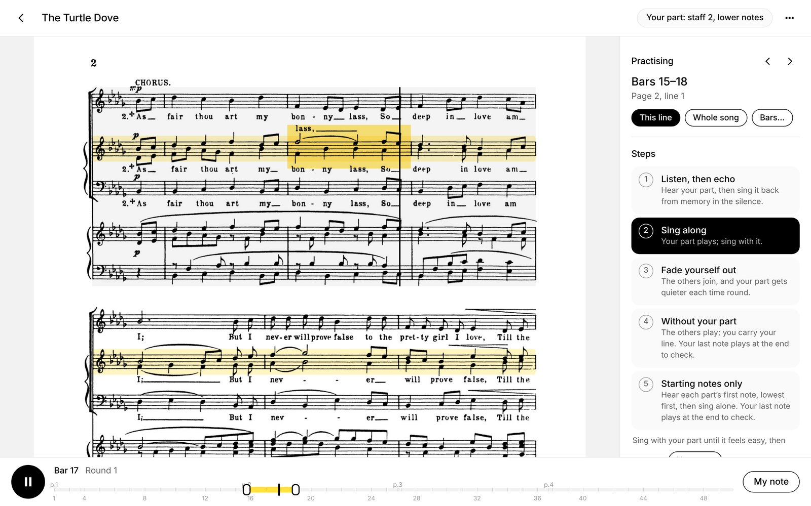

# Sectional

Practice your part at home, with the whole ensemble.

In a choir, a band or an orchestra, and want to practice at home, but there's no one to play the
other parts with you? Take a photo of your music: Sectional reads it with the
[Legato 2](https://huggingface.co/guangyangmusic/legato-2) music-recognition model, finds your part
(even when two parts share a staff), plays it along with everyone else's, and takes you step by
step from hearing it to holding it on your own, following along on your page as it plays.

It runs entirely on your own computer, so it's free: no subscription, no account with us.

- **A way to practice, not just playback:** five steps, the way a section leader would teach it.
- **On your own page:** the bar being played lights up on the music you were given.
- **It checks its own reading:** missed staves and bars that don't add up are read again and fixed.
- **Voices and instruments:** parts for transposing instruments, like a B♭ clarinet or an F horn,
  are played at the pitch they sound.

By Will Gao. A mention is appreciated, but not required. MIT licensed; retain the copyright and
license notice as required by MIT.



## See it first

**[Open the live demo](https://wgaostudio.github.io/sectional-demo/)**: four pages of Vaughan
Williams's *The Turtle Dove* for men's chorus and piano, read ahead of time. Pick a voice or an
instrument and practice in the browser. Nothing to install.

## How you practice

Tell the app what you sing or play; it guesses your staff (tap another on the page to change it).
Choose a line on the page, a few bars or the whole piece, and work up the steps:

1. **Listen, then echo.** Your part plays, then the same bars go silent while you sing or play
   them back.
2. **Sing or play along.** Your part plays; join in.
3. **Fade yourself out.** The other parts join, and your part gets quieter each time round.
4. **Without your part.** The others play and you carry your line. Your last note plays at the
   end so you can check you stayed on pitch.
5. **Starting notes only.** Each part's first note is played from the lowest part up, the way a
   rehearsal pianist gives them, and then you're on your own. The same check at the end.

The bar being played is highlighted on your staff. **My note** plays your next note any time.
Playback follows the score's dynamics, hairpins, slurs and staccatos, and shapes each bar the way
musicians do (switch it off under Sound). Space plays and pauses; ← and → move line by line;
1–5 pick a step.

## Run it yourself

Made and tested on a Mac with Apple silicon; reading takes about a minute per page there.

```bash
git clone https://github.com/wgaostudio/sectional.git
cd sectional
./setup.command      # or double-click it in Finder
./start.command      # opens http://localhost:8765
```

`setup.command` installs Python packages with [uv](https://docs.astral.sh/uv/), asks you to sign
in to Hugging Face, downloads Legato 2 (about 1.9 GB) and checks that it reads a test page
correctly. Legato 2 is free, but gated: accept its terms on the
[model page](https://huggingface.co/guangyangmusic/legato-2) and use a "Read" token.

On Linux or Windows with an NVIDIA GPU, do the same by hand: create a Python 3.12 environment,
`pip install -r requirements.txt`, run `hf auth login`, then `python -m app.selftest` and
`python -m app.main`. Without a GPU it runs on the CPU, much more slowly.

To try practicing before reading anything, choose **Try a sample piece** on the first screen.
To add your own, choose **Add your music** and pick photos (one per page) or a PDF. Pages
without music, like a cover, are left out; tap a page to change that. Pieces are kept in
`library/`.

## How it works

1. **Read.** A detector finds each line of music, and Legato 2 reads it into
   [ABC notation](https://abcnotation.com), with the line before it as context, as in the model's
   paper ([arXiv 2607.05769](https://arxiv.org/abs/2607.05769)). Broken outputs are retried and
   salvaged part by part.
2. **Repair.** Staves the reading missed are found by comparing what was read with the ink on the
   page, cut out and read again on their own (`app/repair.py`). Then every bar of every sung staff
   is checked against rules written music almost always keeps (`app/check.py`): each part fills
   the bar, a tied note carries on at the same pitch, a staff with two parts has two notes or a
   rest at every moment. Where a bar breaks them, the staff is read again on its own and with its
   neighbour, and each bar is taken from the reading that keeps the rules best, or that the other
   two agree on.
3. **Line up.** Every part is measured bar by bar and lined up, so a misread note length can't
   push one part out of step (`app/abc_time.py`). Pick-ups, short bars at the end of a verse and
   stray rests at fermatas are recognized.
4. **Find your part.** Parts are matched to the staves on the page by clef, and two parts written
   on one staff are separated into upper and lower notes. Sung lines read in the wrong octave are
   moved into the range singers on that clef actually sing, and parts for transposing instruments
   are played at the pitch they sound (`static/parts.js`).
5. **Play.** A small sound engine (`static/synth.js`) gives every note its own loudness curve, so a
   crescendo keeps growing through a held note, using sampled sounds that hold as long as the note
   is written.

The page geometry (staves, clefs, bar lines) comes from simple image analysis in `app/layout.py`.

## Limits

- **The model makes mistakes.** Pitches one step off, missed marks and missed staves are the usual
  ones, more so on old or faint scans. Compare with **⋯ › Check the notes the app read**, and
  confirm at rehearsal: wrong notes learned at home are hard to unlearn.
- **Tested on few scores.** Most of the tuning was done on choral music, one men's chorus with
  piano above all. Band and orchestra scores, a cappella and other layouts may expose new
  problems; issues with an example page are very welcome.
- **Instruments.** A staff is recognized by the instrument named at its start ("Clarinet in B♭",
  "Horn in F"). An unnamed staff you choose as a player is taken to be your own part, written for
  your instrument; a staff named for singers is taken as written at sounding pitch.
- **Copyright.** Much printed music is under copyright; please don't redistribute pages you don't
  have rights to.

## Project layout

```
app/          local server (FastAPI) and the reading pipeline
  omr.py        Legato 2: finding lines, reading, retries
  repair.py     re-reading missed staves
  check.py      checking each bar against the rules of written music, and fixing it
  abc_merge.py  joining lines into one tune
  abc_time.py   bar-by-bar timing and lining parts up
  layout.py     staves, clefs and bar lines on the page photo
  song.py       a song's pages, lines and timing
static/       the practice app (plain JavaScript, no build step)
  parts.js      parts, your line, expression, practice passes
  synth.js      sound engine; player.js plays passes in a loop
  soundfonts/   sampled sounds (see NOTICE.md)
samples/      The Turtle Dove, already read, for "Try a sample piece"
tools/        how the long held-note sounds were made, and the demo build
tests/        Python (pytest) and JavaScript (node --test) tests
vendor/legato Legato 2's model code (MIT)
```

## Tests

```bash
pip install pytest numpy pillow && python -m pytest tests
node --test tests/*.test.js
```

## Credits and licenses

Sectional is MIT licensed. It builds on Legato 2 by Guang Yang, Brian Siyuan Zheng,
Victoria Ebert and Noah A. Smith (model weights Apache-2.0,
downloaded from Hugging Face, not included; model code MIT, in `vendor/legato`),
[abcjs](https://github.com/paulrosen/abcjs) (MIT) and the FluidR3_GM sounds by Frank Wen as
converted by Benjamin Gleitz (CC BY 3.0, modified). Details in [NOTICE.md](NOTICE.md).
